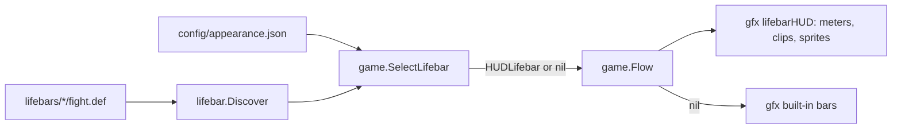

# Native HUD draws the selected MUGEN/Ikemen GO lifebar, built-in bars otherwise

**Context:** Item 039: the match HUD must use a lifebar from `lifebars/<name>/fight.def`, chosen in `config/appearance.json` (roadmap decisions 031, 032), with `default` as fallback.

**Decision:** `native/internal/lifebar` reads fight.def and computes layout (Ikemen GO `fightscreen.go`/`common.go` at 54d4148a: first key wins, `calcBarFillRect`, `LifeBar.step`, `AnimLayout`), `internal/game.SelectLifebar` picks it, `internal/gfx` draws it with GL scissor clips. With no usable lifebar at all the HUD keeps its built-in rectangle bars, and every skipped folder or fallback is printed on stderr. The engine exposes no move type, so a drop in life stands in for Ikemen GO's `getHit` when freezing the trailing fill. Lifebar sprites are found beside the def, then in the content root, then in `common/` (Ikemen GO: def, motif, root, `data/`). Text uses the built-in font until `.fnt` lands (item 049).

**Reason:** Following Ikemen GO's own code keeps real lifebars placed as they are there; keeping the built-in bars means a game folder without lifebars still plays rather than failing.

**Rejected alternatives:** *Refusing to start without `lifebars/default`* — the game ships no content yet, so every existing folder would break. *A shared Go lifebar library* — roadmap decision 009 keeps lifebar parsing in each app. *Porting `lifebar-viewer-web`'s TypeScript parser* — it follows the file format, not Ikemen GO's drawing rules, which are what must match.
