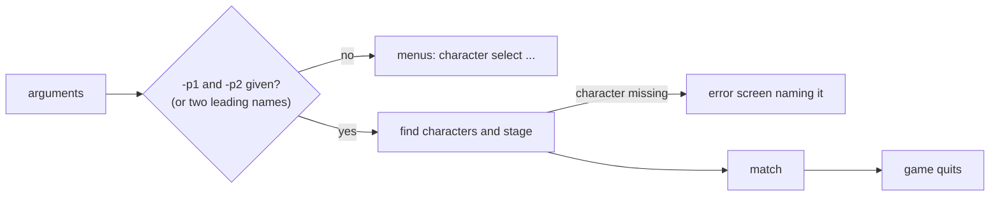

# Command line

The native game takes Ikemen GO's command line (Ikemen GO `src/main.go` `processCommandLine` and `external/script/main.lua` `main.f_commandLine`, commit `54d4148a`), so a launcher written for Ikemen GO or MUGEN works with it. Run `openkakutou -h` for the list.

## Quick versus

Give two characters and the game starts their match straight away, with no menu, then quits when the match ends. This is **quick versus**; it is not the **Versus** mode, which goes through the select screens (see [modes.md](modes.md)).

```sh
openkakutou kfm kfm
openkakutou kfm "Ryu/Ryu Groove.def" -s Training -rounds 3 -time 60 -p2.ai 1
openkakutou -p1 kfm -p2 kfm -p1.life 500
```



The diagram shows what the game does with its arguments: two characters skip the menus, anything else opens them.

| Option | Meaning |
|---|---|
| `<p1> <p2>` | The first two names, before any option, are player 1 and player 2. |
| `-p1 <char>`, `-p2 <char>` | Player 1, player 2. |
| `-p<n>.ai <level>` | Player 1 or 2 is played by the CPU when the level is above 0. The level itself is not used yet: the CPU opponent has a single behaviour. |
| `-p<n>.life <life>` | Player n's life for round 1, 1 to 1000. |
| `-p<n>.power <power>` | Player n's power for round 1, 0 to 3000. |
| `-rounds <num>` | Rounds to win the match (default 2, so best of 3). |
| `-time <num>` | Round time in seconds; `-1` for no limit (default 99). |
| `-s <stage>` | The stage. Not found: the default stage is used, with a notice. |

**Finding a character.** `kfm` is `chars/kfm/kfm.def`; `kfm/kfm2.def` is `chars/kfm/kfm2.def`; a name without `.def` that holds a folder (`Ryu/Ryu Groove`) is tried as a file first. Each is looked for in the content folder, then in `chars/`, then in `common/` (Ikemen GO's `data/`). Names are matched without case. An absolute path is used as it is. A character not found is an error screen naming it.

**Finding a stage.** The same, under `stages/`: `Training` is `stages/Training.def` or `stages/Training/Training.def`. Without `-s`, the default stage is `stages/stage0.def`, as in Ikemen GO, or else the first stage found.

**Leaving.** Escape during the match opens the pause menu; its Exit quits the game, as there is no menu to go back to (no Character Change entry here).

## Other options

| Option | Meaning |
|---|---|
| `-h`, `-?` | Lists the options. |
| `-windowed` | Accepted; the game always runs in a window. |
| `-width <num>`, `-height <num>` | Window size. |
| `-nomusic` | No stage music. |
| `-nosound` | No sound at all. |
| `-content <folder>` | OpenKakutou only: the folder holding `chars/`, `stages/` and `common/` (default: the program's folder). |
| `-frames <num>`, `-capture <file.png>` | OpenKakutou only: quit after that many frames, saving the last one (tests). |

## Ikemen GO options not supported yet

Each one is accepted and named in a notice (`... is not supported yet, ignored`), so the match still starts.

| Options | Why |
|---|---|
| `-p3` and above, `-tmode1`, `-tmode2` | Team modes need more than one character per side in the engine. |
| `-p<n>.color` | Palette choice is not drawn by the native game yet. |
| `-p<n>.lifeMax`, `.dizzyPoints`, `.guardPoints` | The engine has no per-character max life, dizzy or guard points yet. |
| `-p<n>.input` | No input remapping yet (backlog `022`). |
| `-draws` | Draw games are not counted separately yet. |
| `-r`, `-fight`, `-storyboard`, `-loadmotif` | Screenpacks, lifebars and storyboards are not loaded yet (backlog `030`, `039`). |
| `-ip`, `-tcpport`, `-udpport` | No netplay. |
| `-log` | No match statistics file. |
| `-setvolume`, `-nojoy`, `-togglelifebars`, `-maxpowermode`, `-ailevel`, `-speed`, `-framerate`, `-stresstest`, `-speedtest`, `-debug`, `-debugdump`, `-config` | Not implemented yet. |
