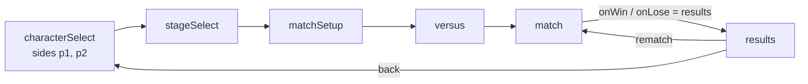

# Game modes

A **mode** is a data file, not code: the sequence of built-in screens a player goes through, and the rules of the matches (roadmap decision `030`). The game ships Versus built in; further modes (arcade, survival, training, watch) are new files in the same format. A mode cannot script anything: it only combines what the game offers.

Versus (a mode) is not quick versus: quick versus starts one match straight from the command line, without any menu, as MUGEN and Ikemen GO do (see [command-line.md](command-line.md)).

- Example: [`native/internal/mode/versus.jsonc`](../native/internal/mode/versus.jsonc)
- Where the game reads it: the desktop game plays Versus from `modes/versus.jsonc` in its game folder; when that file is missing or invalid it prints why on stderr and uses its built-in copy (the same file).
- JSON Schema: [`native/internal/mode/mode.schema.json`](../native/internal/mode/mode.schema.json)
- Loader: `native/internal/mode` (Go, imported by the native game) and `native/cmd/mode-wasm` (the same loader built to WebAssembly for the web game)

## How a mode runs

The diagram shows Versus: the flow's screens in order, then what follows a match. A ladder mode (arcade) would set `onWin: nextOpponent` to fight the next CPU opponent, and `onLose: continue` to show the continue screen.

## File

A mode is one JSONC file: JSON with `//` and `/* */` comments and trailing commas allowed.

| Field | Type | Meaning |
|---|---|---|
| `$schema` | string, optional | Path or URL of the schema, for editors. |
| `formatVersion` | `1` | Format version. Only `1` exists. |
| `id` | non-empty string | Stable identifier, e.g. `versus`. |
| `name` | non-empty string | Name the main menu shows. |
| `flow` | non-empty array of steps | The screens, in order. Must include a `match` screen. |
| `rules` | object | The match rules, below. |

Unknown fields are refused, so a typo is reported instead of silently ignored.

### Flow steps

Each step is `{ "screen": <type>, "params": { ... } }`; `params` is optional.

| `screen` | Shows | `params` |
|---|---|---|
| `characterSelect` | The character select screen. | `sides` (required): the sides that pick here, `["p1"]`, `["p2"]` or `["p1", "p2"]`. |
| `stageSelect` | The stage select screen. | none |
| `matchSetup` | Rounds, time limit and who controls player 2, when the rules leave it open. | none |
| `versus` | The VS screen before a match. | none |
| `match` | The fight. | none |
| `results` | The match result, with rematch or back to selection. Must come after a `match`. | none |
| `continue` | The continue countdown after a loss. | none |
| `victory` | The ending after the last ladder opponent. | none |

Title, main menu, options, pause and move list belong to the game itself, not to a mode's flow. How each screen looks comes from the screenpack (decision `029`), never from the mode.

### Rules

| Field | Type | Meaning |
|---|---|---|
| `sides` | exactly 2 objects | Player 1's side, then player 2's. |
| `sides[].control` | `human`, `cpu` or `humanOrCpu` | Who plays the side; `humanOrCpu` is chosen on the match setup screen. |
| `sides[].characters` | integer ≥ 1 | Characters per side. |
| `rounds` | odd integer ≥ 1 | Best of N rounds. |
| `timeLimitSeconds` | integer ≥ 0 | Round time limit; `0` means no limit. |
| `opponents.kind` | `chosen` or `ladder` | Opponents picked on the select screen, or a ladder of CPU opponents. |
| `opponents.count` | integer ≥ 1 | Ladder length. Required for `ladder`, refused otherwise. |
| `onWin`, `onLose` | `results`, `nextOpponent`, `continue` or `gameOver` | What follows a won or a lost match. |

The native game does not run the `continue` and `victory` screens, nor the outcomes other than `results`, yet: they show an error screen naming them.

## Errors

A mode that breaks a rule is refused with an error naming the file, the field as a JSON path, and the reason, e.g. `modes/arcade.jsonc: rules.rounds: must be odd (best of N)`. The WebAssembly build returns the same three parts as `{"ok": false, "error": {"file", "field", "reason"}}`.
