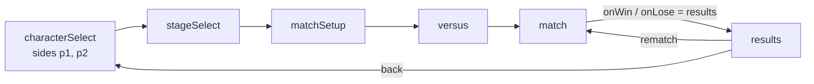
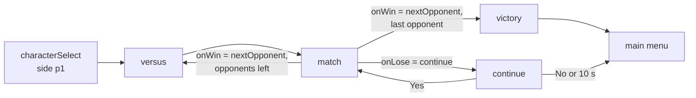

# Game modes

A **mode** is a data file, not code: the sequence of built-in screens a player goes through, and the rules of the matches (roadmap decision `030`). The game ships Arcade (a ladder of CPU opponents), Training (one player against a dummy, no time limit, life refilled), Versus and Watch (two CPUs fight, the player picks both fighters) built in; further modes (survival, for example) are new files in the same format. A mode cannot script anything: it only combines what the game offers.

Versus (a mode) is not quick versus: quick versus starts one match straight from the command line, without any menu, as MUGEN and Ikemen GO do (see [command-line.md](command-line.md)).

- Examples: [`native/internal/mode/arcade.jsonc`](../native/internal/mode/arcade.jsonc), [`native/internal/mode/training.jsonc`](../native/internal/mode/training.jsonc), [`native/internal/mode/versus.jsonc`](../native/internal/mode/versus.jsonc), [`native/internal/mode/watch.jsonc`](../native/internal/mode/watch.jsonc)
- Where the game reads it: the desktop game reads every `.json` or `.jsonc` file of the `modes/` folder in its game folder (folder and extension in any case). It lists them in the main menu, in file-name order ignoring case, then Quit. A file that is not a valid mode is left out and its error (file, field, reason) is printed on stderr, as is a second file with the id of an earlier one. The built-in modes are Arcade, Training, Versus and Watch: for each one, when no valid mode has its id (`arcade`, `training`, `versus`, `watch`), the built-in (the same file as the shipped `modes/arcade.jsonc`, `modes/training.jsonc`, `modes/versus.jsonc` or `modes/watch.jsonc`) is added after the others, with a notice on stderr, e.g. `modes/watch.jsonc not found or invalid, using the built-in Watch mode`.
- JSON Schema: [`native/internal/mode/mode.schema.json`](../native/internal/mode/mode.schema.json)
- Loader: `native/internal/mode` (Go, imported by the native game) and `native/cmd/mode-wasm` (the same loader built to WebAssembly for the web game)

## How a mode runs



The diagram shows Versus: the flow's screens in order, then what follows a match. Arcade, a ladder, sets `onWin: nextOpponent` and `onLose: continue`:



The diagram shows what follows a match in a ladder mode: the next opponent's VS screen, the victory screen after the last one, the continue screen after a loss, and where each ends. The outcome `gameOver` goes straight to the main menu.

## File

A mode is one JSONC file: JSON with `//` and `/* */` comments and trailing commas allowed.

| Field | Type | Meaning |
|---|---|---|
| `$schema` | string, optional | Path or URL of the schema, for editors. |
| `formatVersion` | `1` | Format version. Only `1` exists. |
| `id` | non-empty string | Stable identifier, e.g. `versus`. |
| `name` | non-empty string | Name the main menu shows. |
| `flow` | non-empty array of steps | The screens, in order. Must include a `match` screen. |
| `rules` | object | The match rules, below. |
| `pause` | array of ids, optional | Entries the pause menu gets besides the game's own, from the set the game offers, see below. |

Unknown fields are refused, so a typo is reported instead of silently ignored.

### Flow steps

Each step is `{ "screen": <type>, "params": { ... } }`; `params` is optional.

| `screen` | Shows | `params` |
|---|---|---|
| `characterSelect` | The character select screen. | `sides` (required): the sides that pick here, `["p1"]`, `["p2"]` or `["p1", "p2"]`. |
| `stageSelect` | The stage select screen. | none |
| `matchSetup` | Rounds, time limit and who controls player 2, when the rules leave it open. | none |
| `versus` | The VS screen before a match. | none |
| `match` | The fight. | none |
| `results` | The match result, with rematch or back to selection. Must come after a `match`. | none |
| `continue` | The continue countdown after a loss. | none |
| `victory` | The ending after the last ladder opponent. | none |

Title, main menu, options, pause and move list belong to the game itself, not to a mode's flow. How each screen looks comes from the screenpack (decision `029`), never from the mode.

### Rules

| Field | Type | Meaning |
|---|---|---|
| `sides` | exactly 2 objects | Player 1's side, then player 2's. |
| `sides[].control` | `human`, `cpu` or `humanOrCpu` | Who plays the side; `humanOrCpu` is chosen on the match setup screen. |
| `sides[].characters` | integer ≥ 1 | Characters per side. |
| `rounds` | odd integer ≥ 1 | Best of N rounds. |
| `timeLimitSeconds` | integer ≥ 0 | Round time limit; `0` means no limit. |
| `opponents.kind` | `chosen` or `ladder` | Opponents picked on the select screen, or a ladder of CPU opponents. |
| `opponents.count` | integer ≥ 1 | Ladder length. Required for `ladder`, refused otherwise. |
| `opponents.final` | non-empty string, optional | Folder name of a character fought after the `count` ladder opponents (a boss). `ladder` only. |
| `onWin`, `onLose` | `results`, `nextOpponent`, `continue` or `gameOver` | What follows a won or a lost match. |
| `roster` | object, optional | Which characters and stages the mode shows, see below. Absent: everything. |
| `training` | boolean, optional | `true` turns on the training behaviour, see Training. Default `false`. |

### Pause entries

The pause menu always lists the game's own entries: Continue, Restart, Character Change (not in quick versus), Move List, Options and Exit. A mode's `pause` array adds entries from the set the game offers, inserted after Restart in the order the mode lists them. An id outside the set, or listed twice, is refused with the usual file, field (`pause[1]`) and reason error. Arcade, Versus and Watch list none.

| Id | Entry | Does |
|---|---|---|
| `resetPositions` | Reset Positions | Puts both fighters back at their round-start positions, life and state, keeps the other settings (the dummy) and closes the menu. |
| `dummy` | Dummy: Stand | Confirm cycles the dummy (side 2) through Stand (no input), Crouch (holds down), Jump (holds up), Guard (holds back, away from player 1, whichever side it stands on) and CPU (the CPU opponent drives it), then Stand again. Stand is the default each time the mode is entered. The menu stays open. |

Guard only holds back: the dummy blocks once the engine guards (engine backlog item 023); until then it takes the hits.

### Training

`rules.training: true` makes a match a training match: a fighter whose life is below its maximum and has not changed for 60 ticks (1 second without a hit) gets its full life back, and a life that reaches 0 is refilled at once, so no round ends by KO and the match never ends (`onWin` and `onLose` are required by the format but never followed). With `timeLimitSeconds: 0` there is no timer either. The built-in Training mode has side 1 `human`, side 2 `cpu` (the dummy; its input follows the Dummy pause entry), one round, no `matchSetup`, `versus` or `results` screen, and `pause: ["resetPositions", "dummy"]`; Move List stays reachable from its pause menu.

A KO the engine reports in the tick it happens is dropped, not undone: the fighter's life is back before the next tick, but the hit reaction that took it to 0 still plays.

### Ladder

A mode whose `opponents.kind` is `ladder` draws its ladder once the player has picked (the first `versus` or `match` screen after the `characterSelect`; going back to the select draws it again): `count` characters at random, without repeats, from the opponent pool (`roster.characters.opponents`) less the `final` and less the player's own character, which is fought only when nothing else is left; then the `final`, when it is installed (a `final` that is not is reported on stderr at startup and skipped). A pool with fewer candidates than `count` gives a shorter ladder, and a ladder with nobody to fight shows an error screen. Every fight is on a stage drawn at random among the visible stages (`roster.stages.select`). The game seeds its random source from the clock.

- `onWin: nextOpponent`: the `versus` screen of the next opponent (the `match` screen when the flow has no `versus`), and after the last one the `victory` screen, then the main menu. Without a `victory` step in the flow the mode shows an error screen.
- `onLose: continue`: the `continue` screen shows the player's character, "Continue?", a 10 second countdown (one `tick` sound each second) and Yes / No, laid out as the screenpack's `continue.json` says (horizontal menus follow `direction: "horizontal"`; left and right choose). Yes fights the same opponent again, on the same stage; No, or the end of the countdown, plays the `gameOver` sound and shows the main menu. Without a `continue` step the mode shows an error screen.
- `gameOver`: straight to the main menu.
- The `victory` screen shows the player's character and name and a message for the screenpack's `durationMs` (default 8000), then the main menu; confirm skips it.

The screenpack draws both screens and decides their music (`continue.json` is silent by default) and the `tick` and `gameOver` sounds. The Arcade mode is `onWin: nextOpponent`, `onLose: continue`, a ladder of 6, 3 rounds, 99 seconds and no roster filter; to add a boss, edit the file: set `opponents.final` and hide the boss from the select screen with `roster.characters.select.exclude`.

### Roster filter

`rules.roster` lets a mode hide characters and stages, by folder name for a character and by file name (without `.def`) for a stage, matched ignoring case. Every level is optional:

```jsonc
"roster": {
  "characters": {
    "select":    { "include": ["..."], "exclude": ["..."] }, // what the character select screens show
    "opponents": { "include": ["..."], "exclude": ["..."] }  // the pool a CPU opponent can come from
  },
  "stages": {
    "select": { "include": ["..."], "exclude": ["..."] }     // what the stage select screens show
  }
}
```

In a list, `include` absent means every name, an `include` that is an empty array means none, and `exclude` then removes names. Both are arrays of non-empty strings; any other key is refused with the usual file, field and reason error. An arcade-like mode keeps its boss off the select screen but fights it:

```jsonc
"roster": {
  "characters": {
    "select":    { "exclude": ["boss"] },
    "opponents": { "include": ["kfm", "boss"] }
  }
}
```

A mode that leaves no character (or no stage) on a select list shows an error screen naming the mode and the list, and Enter goes back to the main menu. A name that matches no installed character or stage is not an error: the game prints a notice on stderr once at startup, and the name matches nothing. The native game uses `opponents` through the opponent pool, which a ladder (`opponents.kind: "ladder"`) draws from; `chosen` modes ignore it.

## Errors

A mode that breaks a rule is refused with an error naming the file, the field as a JSON path, and the reason, e.g. `modes/arcade.jsonc: rules.rounds: must be odd (best of N)`. The WebAssembly build returns the same three parts as `{"ok": false, "error": {"file", "field", "reason"}}`.
